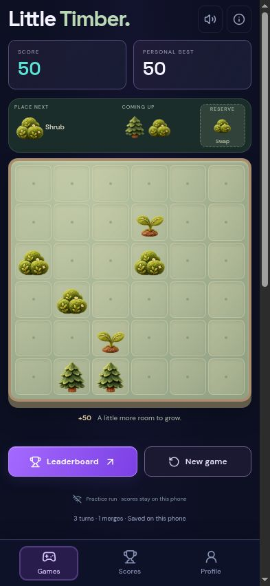

# Little Timber

A 6×6 survival-score woodland merging game. Start from the arcade card or `#timber`.

## Rules v1

- Orthogonally connected groups of at least three upgrade on the placement tile. All pieces in the connected group are consumed. Resolve all chains before moving bears.
- Sprout → Shrub → Pine → Cabin → Cottage → Lodge → Manor → Treetop Palace → Cloud Village. Three Cloud Villages recycle into one Cloud Village and award its merge score.
- Bears start entering draws after 12 completed turns. Draw probability is 4.5% through turn 39, then 7.5%. When four bears are already on the board, new draws suppress bears (previously queued bears can still arrive).
- Existing bears each move once to a randomly chosen orthogonal empty neighbour in stable board order. Newly placed bears wait until the following turn. Entire connected bear groups with no empty neighbouring escape become Berry Patches, before and after movement.
- Berry Patch → Picnic Spot → Woodland Park. Three parks recycle into one park. Newly formed patches resolve in ascending tile order.
- One reserve use per completed turn: store the current piece or swap with the held piece. Storing into an empty reserve advances the queue without moving bears; further reserve use waits until a placement or Helping Paw turn. This prevents discarding the queue indefinitely.
- Magic Button completes an eligible matching group; no valid merge means no placement. If multiple merges are possible, pick the highest-scoring upgrade with a stable tier tie-break. It never becomes a stone.
- Helping Paw deletes one occupied tile, including a bear, then resolves trapping and bear movement as a turn. Empty tiles are not legal targets.
- Game over requires no legal current placement and no legal placement available through the unused reserve. An empty reserve can expose the next queued piece; later queue pieces do not count as rescues.

## Score and persistence

An upgrade to main tier `t` earns `10 × 4^(t−1)` base points. Secondary tiers start at 60 and multiply by four. Apply a 25% bonus for each connected piece beyond three, then a 50% bonus for each successive merge in that turn. Placements and removals earn no points.

The browser saves seed, complete action history, run ID, and revision. Loading replays the history rather than trusting a stored score or board. Another tab changing the saved revision blocks play until the latest village is loaded. Offline games retain personal bests but do not publish.

Online runs use server-issued seeds and the existing run/score tables, with rules version 1. Actions are single base36 tile indices or `~` for reserve. Verification batches contain at most 1,000 actions, reuse the existing checkpoint column, and check offset and history hash. Only server-replayed game over can publish. Qualifying finished games use the existing Top 10, one entry per run, and one authenticated entry-only name edit. No schema migration is required. The shared 30-day online-run expiry applies.

## Artwork and controls

Detailed original plush illustrations use a shared transparent 4×4 atlas: fuzzy velvet plants and bear, stitched roofs, cedar beams, glowing windows, flower boxes, layered treetop buildings, and fabric tools. The 1254px atlas is packaged as WebP with alpha, cached for offline play, and used consistently on the board, queue, reserve, guide and game card. The original SVG set remains as a loading-error fallback. All tiers, both tools, bear and secondary pieces have their own illustrations. Includes gentle synthesized sound, mute, reduced-motion support, keyboard placement and focus previews, help, and confirmation before abandoning an active game.

## Validation and release

- Engine tests cover merging, chains, terminal tiers, wildcards, reserve, bear movement/trapping, full-board rescues, deterministic replay across 35 complete sessions, save validation and batch validation.
- API tests check that forged scores and premature finished flags cannot publish, malformed histories are rejected, retries do not duplicate entries, and a name can change once.
- Browser inspection at 320px and 393px checks board, tray, navigation, reserve, a real four-piece merge, restoration after reload, and profile modal pausing. This is Chromium layout inspection, not a physical iPhone/Safari test.
- `pnpm test`, `pnpm typecheck`, `pnpm build`, `pnpm build:pages`.
- After merge, deploy the Worker backend with these routes as well as the generated GitHub Pages files. The Pages client uses the existing Sites API origin, so the backend needs this version to issue and verify Little Timber runs.

## Detailed artwork v2

Generated as one transparent sprite atlas using the built-in image generation tool, with Maple Merge’s velvet material sheet as a style reference. Sixteen equal cells in row-major order: Sprout, Shrub, Pine, Cabin; Cottage, Lodge, Manor, Treetop Palace; Cloud Village, Bear, Berry Patch, Picnic Spot; Woodland Park, Magic Button, Helping Paw, decorative logs. Game artwork uses the first fifteen cells and preserves the established tier identities. Rendering clips each cell within SVG so neighbours cannot bleed into a piece. The WebP conversion changes encoding only; no sprites are cropped or painted over.

Art brief: “Luxuriously detailed miniature velvet plush, tactile fuzzy fibres, softly stuffed forms, embroidered seams, warm upper-left studio lighting. Distinct silhouettes and increasing building grandeur; earthy sage greens, cedar, teal and terracotta roofs, honey-gold windows, muted lavender late tiers. Each object isolated in a transparent equal square cell. No text, panels, borders, logos or pedestals.”
